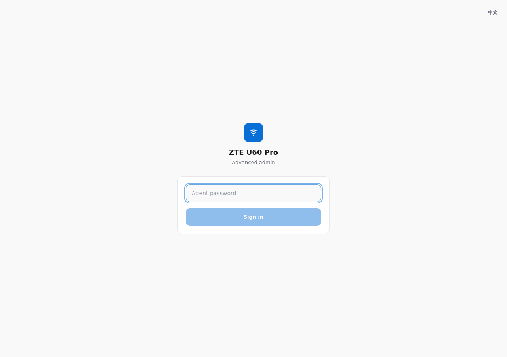
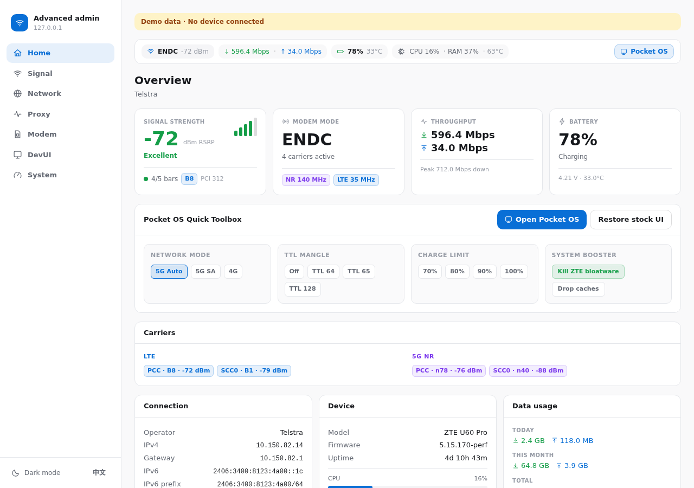
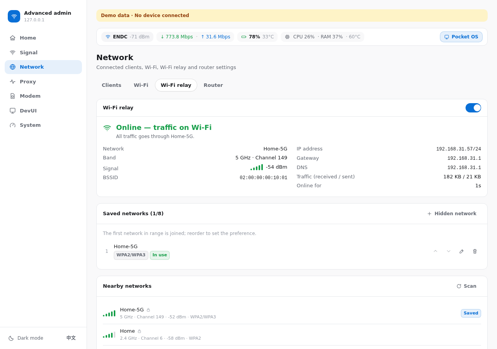
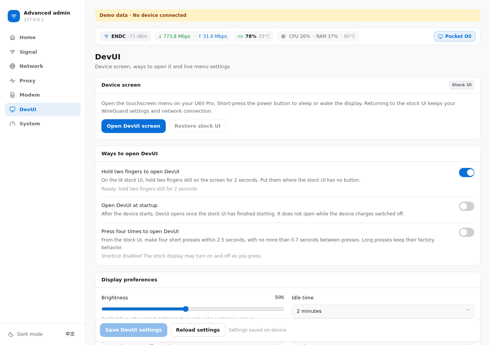
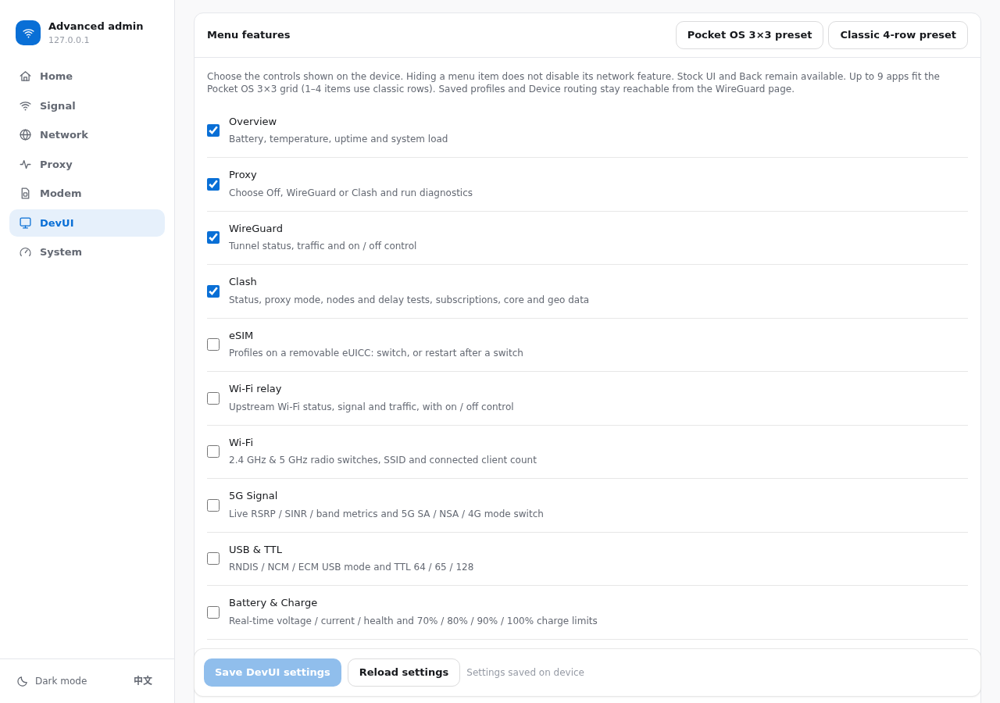

# Dashboard

React 19 + Vite + Tailwind SPA served from the device itself (isolated
upstream OpenWrt uhttpd on port 8080, release files selected by `/data/www.current` (legacy `/data/www` fallback)), talking to the
agent on port 9090. It is kept separate from ZTE's patched stock-UI uhttpd,
whose singleton ubus object makes a second UCI instance unreliable.

## Layout





Seven navigation groups — bottom tab bar on phones, sidebar on desktop,
light/dark theme (auto + manual), each group lazy-loaded:

| Group | Contents |
|---|---|
| **Home** | signal, modem mode, throughput, battery, connection, device, data usage — backed by the single batched `/api/dashboard` poll; a quick toolbox (open the DevUI / restore the stock UI, network mode, TTL, charge limit, stop vendor processes, drop caches). A status bar above every page shows signal, speed, battery and load from the same poll |
| **Signal** | per-carrier LTE/NR detail (PCI, ARFCN, RSRP/RSRQ/SINR) + network mode, band lock, one-tap cell lock from live cells |
| **Network** | clients by Wi-Fi/USB-C/Ethernet with link details, per-band Wi-Fi configuration, Wi-Fi relay (see below), LAN/DHCP and DNS |
| **Proxy** | **Active proxy** selector (Off / WireGuard / Clash, `/api/proxy`), then **Configure** either backend: WireGuard status, saved configurations and device routing; Clash overview with diagnostics, subscriptions, nodes, devices, connections, logs and advanced settings |
| **Modem** | APN profiles (with carrier presets), eSIM on a removable eUICC ([ESIM.md](ESIM.md)), data usage + reset day, TTL clamping, SMS (inbox/sent, compose, delete) |
| **DevUI** | the device touchscreen menu: open it, ways to open it on the device, brightness, idle time and action, startup page and menu items |
| **System** | thermals, battery health, charge control, signal/connection loggers, AT console, on-demand process list, device/SIM info, USB mode + powerbank, power actions |

The agent exposes exactly what these screens use and nothing else — the
unsurfaced extras (DoH proxy, speed test, scheduler, SMS forwarding, SIM PIN
flows, calls/USSD/STK) were removed rather than left dangling. See
[AGENT.md](AGENT.md) for the route table, and
`scripts/check-api-contract.py`, which fails if the two drift apart.

## Source layout

```
web-app/src/
  App.tsx            auth gate + group switching (lazy-loaded)
  app/               shell (sidebar/bottom tabs), login, theme, home poll context
  data/
    client.ts        token handling, envelope unwrapping, timeouts
    api.ts           endpoint bindings + firmware response mappers
    poll.ts          visibility-aware, non-overlapping poller with SWR cache
  ui/                design-system primitives (cards, controls, toast, confirm)
  i18n/              t()/tm() and the Chinese dictionaries (zh/<area>.ts)
  icons.tsx          inline SVG icon set (no icon dependency)
  features/
    home/            Overview — single batched /api/dashboard poll
    signal/          Overview + Mode & Locking
    network/         Clients + Wi-Fi + Wi-Fi relay + Router
    proxy/           Active proxy selector + Clash tabs; wireguard/ holds WireGuard's settings
    modem/           APN + eSIM + Data + TTL + SMS
    system/          Metrics + Tools + Settings
```

## Wi-Fi relay



**Network → Wi-Fi relay** (`UplinkTab.tsx`, agent `wifi_uplink.rs`, `/api/wifi/uplink`)
makes the router join an upstream Wi-Fi network and send all traffic through it while
that network reaches the internet, falling back to the cellular connection otherwise.

- **Status card:** the state (off, unavailable, connecting, getting an IP address,
  checking internet access, online with traffic on Wi-Fi, no internet with traffic on
  cellular, needs a web login, login mode), the agent's reason, and while joined the network, band and channel, signal,
  address, gateway, DNS and traffic. The switch saves `{expected_revision, enabled}`; a
  409 reloads. Turning it on the first time in a browser explains what changes: the
  hotspot may move to the upstream channel, IPv6 for LAN devices is held while on Wi-Fi,
  and the upstream subnet must differ from the LAN.
- **Web login:** a network with a captive portal shows **Start web login (10 min)**
  (`POST /api/wifi/uplink/login`); during login mode the card links to the portal's login
  page, counts down and offers **End login mode**. The same button is offered when the
  network has no internet (portals that only hijack DNS).
- **Saved networks** (up to `max_networks`): the first one in range is joined, so the
  order is the preference (up/down). Edit changes security, password or the hidden flag;
  an empty password keeps the saved one. A save sends the whole list, without passwords
  that did not change.
- **Nearby networks:** **Scan** (`POST /api/wifi/uplink/scan`, a few seconds) lists
  networks strongest first; WEP and enterprise networks are shown but cannot be chosen.
  Picking one opens **Save** / **Save and connect** (the latter puts it first and turns
  the relay on). **Hidden network** adds one by name.
- Names and passwords are checked as the agent checks them (1–32-byte name;
  8–63 printable ASCII characters or a 64-digit key, which WPA3 does not accept).
- The tab polls every 3 s while open.

## DevUI page





## Conventions that keep the device happy

- Home is one batched request (`/api/dashboard`) every 3 s — not nine calls.
- Pollers never overlap (next poll scheduled after the previous completes)
  and pause while the browser tab is hidden.
- Expensive endpoints (`/api/network/clients`, `/api/system/top`) poll
  slowly (15 s) or load on demand.
- Last-good data is cached in memory, so switching tabs renders instantly
  and refreshes in the background.

## Language

The panel is bilingual: Simplified Chinese by default, English from the **EN / 中文**
switch in the sidebar, the mobile header or the sign-in page. The choice is kept in
`localStorage` (`u60.lang`). After sign-in and on every switch the panel also sends it
to `PUT /api/screen/language`, so the device touchscreen (DevUI) shows the same language.

- English source text is the key: `t('Save device choices')`, `t('{n} devices', { n })`.
  Chinese goes in `src/i18n/zh/<area>.ts`.
- Strings defined at module level are marked with `N_()` and shown with `t()`; `t()` is
  read at render time and a language switch remounts the app.
- Messages from the agent stay English on the wire and are shown with `tm()`, which
  translates known ones by exact text or `{placeholder}` pattern (`zh/agent.ts`).
- `npm test` runs `tools/check-i18n.cjs`, which fails on English UI text outside
  `t()`, on missing or conflicting translations, and on unused entries. Run
  `node tools/check-i18n.cjs [path]` to list problems.

## Develop

Requires Node.js `^20.19.0 || >=22.12.0` and npm. Node 18 is unsupported by
the locked Vite toolchain.

```sh
cd web-app
npm ci
npm run dev       # local dev server (expects agent at <hostname>:9090)
npm run build     # tsc + vite build -> dist/
npm run lint
```

Deploy to the device with `./deploy-dashboard.sh` from the repo root. The
script checks Node/npm, runs `npm ci`, builds and uploads the SPA, restarts the
isolated dashboard server, and verifies the page from the device before
reporting success. Run `scripts/zharden.sh` first if that server is not yet
installed.

### Local demo without the device

```sh
cd web-app
bash tools/demo.sh        # dashboard on :8080 + mock agent on :9090
bash tools/demo.sh stop
```

The mock agent (`tools/mock_agent.py`, stdlib-only) serves realistic U60 Pro
data — Telstra ENDC with LTE anchor + n78 NR, live-jittering throughput,
battery, clients, thermals — so every screen can be reviewed without
hardware. Sign in with any password.
