# DevUI device screen

Open **DevUI** in the OpenUI sidebar. This page manages the device's 320×480
touchscreen, which follows the web panel's language (Chinese or English). It provides
**Open DevUI screen**, **Restore stock UI**, the ways to open DevUI from the device
(a two-finger hold, at startup, a four-press power-button shortcut), and saved
preferences. Closing the browser does not close the device screen. Leaving DevUI
never turns a proxy off or changes saved device routing.

## Quick start

1. Deploy the screen with `--screen` (together with the agent of the same version) and
   run `scripts/verify-screen.py` once; until it passes, DevUI does not open from the
   webpage or the device.
2. Open it with **DevUI → Open DevUI screen**, or on the lit stock UI hold two fingers
   still on the screen for two seconds. **Open DevUI at startup** and the four-press
   power-button shortcut are optional.
3. Tap a menu row to open it; **‹ Back** is at the top right and **Stock UI** on the
   main menu leaves DevUI. A short power press turns the display off or on. After the
   idle time (two minutes by default) the screen turns off and DevUI stays, or, if
   chosen, the stock UI returns.

## Opening DevUI from the device

**Two-finger hold** (on by default). On the lit stock UI, hold two fingers still on the
screen for **two seconds**; DevUI opens through its normal startup path. Put the
fingers where the stock UI has no button: the stock UI also receives the touches.
- The agent reads the `sitronix` touchscreen without EVIOCGRAB, beside the stock touch
  bridge (`mtdev2tuio`).
- Exactly two fingers count. One finger (a stock long press), a third finger, a finger
  lifted early, or moving more than a twelfth of the screen does not open DevUI.
- Touches already down when the agent starts, or across dropped events, count only
  after every finger has lifted. The screen must stay lit for the whole hold: a hold
  that starts in the dark does not count, even when touch wake-up lights the screen.
- After a launch, a five-second cooldown applies, and the fingers must lift before
  another hold counts.
- Like the shortcut, it needs a verified screen component, and the supervisor still
  checks the factory boot handshake before it takes over.

**The stock lock screen does not protect DevUI.** The stock UI's lock is a hold on the
screen followed by its PIN, and the agent cannot see whether it is locked, so the hold
opens DevUI from the lock screen too. The four-press shortcut behaves the same.

**Open DevUI at startup** (off by default). Once per boot, after the firmware's boot
barrier (`/tmp/zte_boot_done`), with `zte_topsw_devui` running and the stock daemons
reporting sync, the agent waits five seconds and opens DevUI.
- The stock UI therefore shows briefly first.
- It never opens in power-off charging (`mode_main_state` `mode_power_off…` in
  `/etc/config/zwrt_zte_mc_tmp`), nor again after an agent restart (`/tmp/openui-devui-boot`).
- If the firmware has not finished booting within five minutes, or the open fails,
  the stock UI stays for that boot.

## Power button and stock UI shortcut

Inside DevUI, a short power-button press turns the backlight off; the next short
press wakes it at the configured brightness. A short press lasts 30–799 ms.
Touch actions are ignored while dark, including touches queued across wake-up.
The display stops redrawing while asleep; agent jobs and supervisor heartbeats
continue. This controls the LCD backlight, not whole-device suspend or power-off.

Enable **Press four times to open DevUI** in the webpage and click **Save DevUI
settings**. From the stock UI, make four short presses within **2.5 seconds**,
leaving no more than **0.7 seconds** between presses. The agent waits 350 ms after
the fourth release for the factory callback to settle, then uses its normal
screen startup path. A five-second cooldown prevents repeated launches.
The shortcut is disabled by default on a new installation and persists across
agent restarts after being saved.

The observer reads `pmic_pwrkey` without EVIOCGRAB and does not stop the factory
key service. Stock UI may turn its display on and off during the four presses.
Long presses, auto-repeat, incomplete sequences and dropped events cannot launch
DevUI. Events are drained while the shortcut is disabled or DevUI is already
running, so they cannot be replayed when it becomes enabled. The shortcut requires
a verified screen component and a completed factory boot handshake. It does not
modify factory menus, binaries, boot scripts, power-off or hardware-reset behavior.

## Online settings

| Setting | Behavior |
| --- | --- |
| Two-finger hold | Open DevUI from the lit stock UI; on by default |
| Open at startup | Open DevUI once per boot after the stock UI has started; off by default |
| Four-press shortcut | Enable or disable entry from stock UI with the power button; off by default |
| Brightness | 20–255, shown as a percentage; updates while awake without waking a sleeping panel |
| Idle time | 30–600 seconds; default 120 seconds, measured from touch or a short power press |
| When idle | Turn the screen off and stay in DevUI (default), or return to the stock UI |
| Startup page | Main menu or any visible feature; applies on the next opening |
| Menu features | Up to nine of Overview, Proxy, WireGuard, Clash, eSIM, Wi-Fi relay, Wi-Fi, 5G signal, USB & TTL, Battery & charge, Booster, Saved profiles and Device routing; default Overview, Proxy, WireGuard, Clash |

At least one feature must remain visible and at most nine fit the menu: up to four show
as rows, five to nine as a 3×3 grid of tiles (the toolbox). The DevUI webpage has a
toolbox preset and a classic four-row preset. A saved list
of exactly the four old defaults moves to the new default once. Saved profiles and
Device routing stay reachable from the WireGuard page even when hidden from the menu.
**Stock UI** and **Back** are always available. Hiding a feature only changes the screen menu; it does not disable its
network service. A hidden page with unsaved work remains open until the draft or
operation is resolved. Turning the screen off when idle keeps the open page and its
unsaved choices. Returning to the stock UI when idle discards unsaved device routing
choices, even when the display is asleep.
Recovery restores the brightness recorded before takeover; it may therefore
light the stock display again if it was previously awake.

Click **Save DevUI settings** to persist edits. The screen picks up brightness,
idle time and action, and menu visibility within its two-second polling interval.
The two-finger hold and four-press switches apply at once, opening at startup from
the next boot. Revision
checks reject stale saves from another browser session; **Reload settings**
reloads the device's saved version. Settings contain no passwords, VPN keys, HTML,
scripts or shell commands.

## Screen pages

Rendered by the native preview build (`sh screen/build.sh --preview`), English:

| | | |
| --- | --- | --- |
| 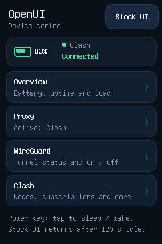 | 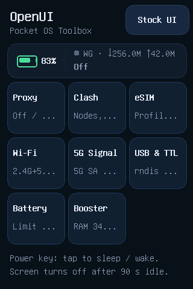 | 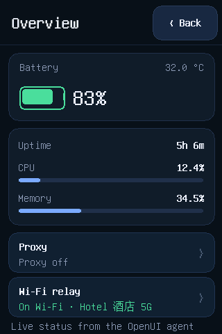 |
| 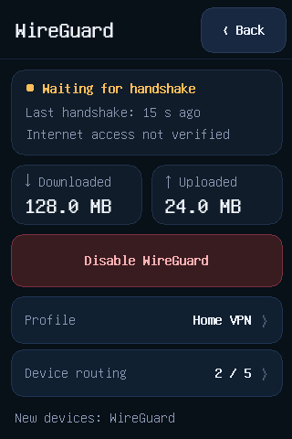 | 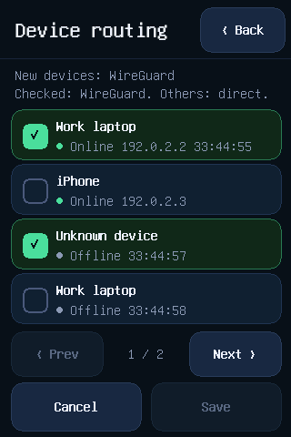 | 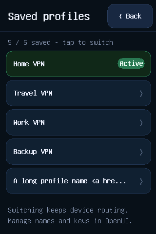 |
| 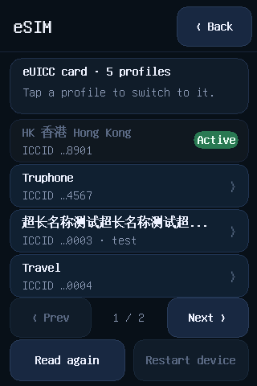 | 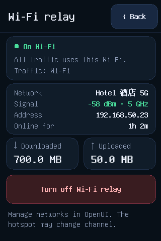 | 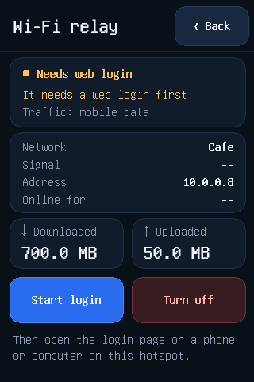 |
| 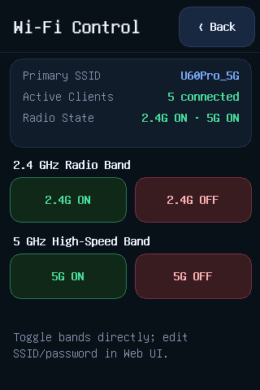 | 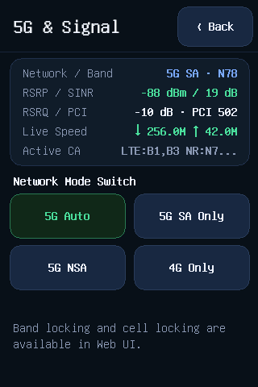 | 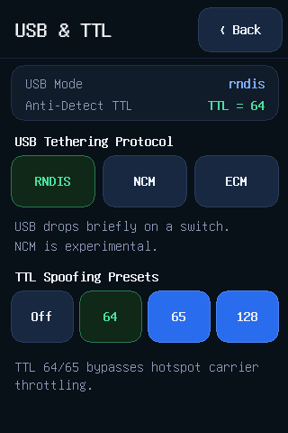 |
| 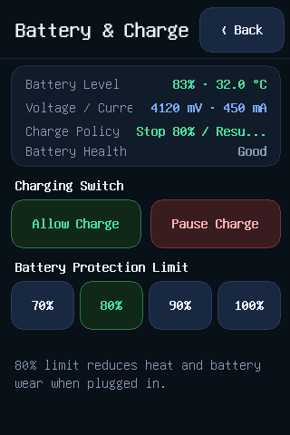 | 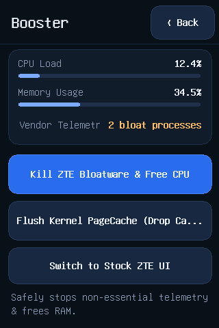 | |

- **Overview:** a battery icon with a proportional fill and large percentage,
  a low-battery color at 20% or below, battery temperature, uptime, CPU and memory.
  Missing battery data displays `--%`. The main menu also shows a battery badge.
- **Proxy:** Off / WireGuard / Clash, with a confirmation before switching or turning
  off and the reason when a backend is not ready; a status card for the active one and
  a **Diagnostics** row (the same checks as the web page: verdict and eight checks over
  two pages). Switching goes through the agent's proxy switch, which turns the other
  backend off in the same transaction.
- **WireGuard:** configuration state, handshake age, per-run tunnel traffic and
  on/off through the proxy switch (switching away from Clash asks first). A recent
  handshake does not claim verified internet access. Keys and configuration imports
  stay in OpenUI.
- **Clash:** running/connected state, active subscription, core version and memory;
  on/off; proxy mode (rule, global, direct); rows to Nodes, Subscriptions, Core & data
  and Diagnostics.
  - **Nodes:** groups four per page, then a group's nodes with their last delay; tap a
    node to select it in a selectable group, **Test** measures the whole group. Flag
    emoji in names are shown as letters (🇭🇰 → HK); the font has no colour glyphs.
  - **Subscriptions:** up to five with traffic and expiry; **Use this subscription**
    or **Update now**. Adding and editing stay on the webpage (no text entry on the
    screen, and the URL is a credential).
  - **Core & data:** installed, previous and latest core versions with their source,
    free space and job progress; **Check**, **Update**, **Roll back** and **Update GEO**
    (each change asks first and restarts a running core).
- **eSIM:** the card in the SIM tray (eUICC, ordinary SIM or none), the running or last
  eSIM job, and up to eight profiles, four per page, by name with the last four ICCID
  digits; tap one to switch to it after a confirmation. **Read again** reads the card;
  the page also reads it on entry until it has been read once. **Restart device** is
  enabled only while a switch waits for the firmware, and asks first. Downloading,
  renaming, deleting and notifications stay on the webpage. See [ESIM.md](ESIM.md).
- **Wi-Fi relay:** the Wi-Fi uplink: state (on Wi-Fi, connecting, getting an address,
  checking, no internet, needs web login, login mode, unavailable or off) with the reason when it is not carrying
  traffic, whether traffic uses Wi-Fi or mobile data, the network name, signal and band,
  address, time online and traffic since the client interface was added. **Turn on** /
  **Turn off** asks first; turning on needs a saved network. Networks and passwords are
  added on the webpage (no text entry on the screen). For a network that needs a web
  login (or has no internet) **Start login** sits next to **Turn off** and starts ten
  minutes of login mode at once; the login itself happens in a browser on a phone or
  computer on the hotspot. A menu item of its own, and a row
  on **Overview** whenever the agent reports the uplink, so it is reachable without
  changing the menu; it returns to the page it was opened from.
- **Toolbox pages** (menu options, shown as tiles with five or more features):
  - **Wi-Fi:** the main SSID, connected clients, and on/off per band (2.4 GHz, 5 GHz)
    through the same Wi-Fi settings as the webpage.
  - **5G signal:** network type and band, RSRP/SINR/RSRQ, PCI, live speed, and the
    preferred network mode (5G auto, 5G SA only, 5G NSA, 4G only).
  - **USB & TTL:** USB mode (RNDIS, NCM, ECM; switching drops USB briefly, NCM is
    experimental) and TTL off/64/65/128.
  - **Battery & charge:** level, temperature, voltage, current and health; allow or pause
    charging; charge limit 70/80/90 % (10 % hysteresis) or none.
  - **Booster:** CPU, memory and vendor processes; stop the optional vendor processes,
    drop the kernel caches, or return to the stock UI.

  Actions apply at once (no confirmation) and are the webpage's own operations.
- **Saved profiles:** up to five named profiles. Switching preserves the current
  enable state and device routing; confirmation remembers the profile ID and
  WireGuard revision to prevent overwriting concurrent webpage edits.
- **Device routing:** four rows per page, including saved offline devices.
  Checked devices use WireGuard; others use normal networking. Edits apply in a
  batch. The new-device default policy is configured on the WireGuard webpage.
  Discovery uses the same bridge, neighbor and Wi-Fi observations as OpenUI,
  not an active reachability probe. Up to 128 choices are projected.

## Build and deployment

The separate screen executable uses aarch64 musl and GPL-3.0-or-later. It talks
to the MIT-licensed agent over a root-only Unix socket. The renderer is adapted
from [33333s/u60pro-devui](https://github.com/33333s/u60pro-devui), using litehtml
0.10, FreeType 2.13.3 and GNU Unifont 17.0.05 OTF. The display layer derives from
the Atomic DRM example in
[amenekowo/mu5250_tweaking](https://github.com/amenekowo/mu5250_tweaking).
Dependency archives and the font are SHA-256 pinned. License texts are retained
under `screen/`; no proprietary device fonts or factory UI assets are bundled.

```sh
ZIG=/path/to/zig sh screen/build.sh
# Native rendering and interaction checks without hardware:
sh screen/build.sh --preview
# Add to the normal component deployment command:
# --screen build/screen/openui-screen
```

Deployment snapshots the previous components and verification marker for rollback.
Restore stock UI before replacing a running screen executable. A new screen binary
invalidates the marker until the device recovery checks pass. The webpage, the
two-finger hold, opening at startup and the power-button shortcut all respect this gate.

The following command temporarily takes over the screen and tests backlight
sleep/wake, startup without touch, crash and stall recovery, web open/close,
duplicate open and the saved idle time and action. With the defaults the screen
turns off after 120 seconds and DevUI stays until the script closes it; with the
stock UI chosen, DevUI returns to it. It does not change WireGuard configuration
or network rules. Do not touch the screen during the test, and disable the
shortcut while carrying out unattended tests.
Existing login credentials are read in memory and are not printed.

```sh
python3 scripts/verify-screen.py --gateway 192.168.0.1 --port 2222 \
  --ssh-key /path/to/id_ed25519
```

After recovery verification, the following optional test checks authenticated
settings, stale-save rejection, live brightness without restarting the panel, and
both idle actions: after a configured 30 seconds the screen turns off and DevUI
stays; once the stock UI is chosen, the next 30 seconds return to it. It restores
the prior display preferences; `--enable-shortcut` deliberately leaves the
four-press shortcut enabled on success. Do not interact with the device during the
idle tests (about a minute).

```sh
python3 scripts/verify-devui-settings.py --gateway 192.168.0.1 --port 2222 \
  --ssh-key /path/to/id_ed25519 --enable-shortcut
```

## Interfaces and process ownership

- Authenticated `GET /api/screen`: availability, verification, lifecycle state,
  settings revision and the status of the shortcut and two-finger-hold listeners.
- Authenticated `POST /api/screen` / `DELETE /api/screen`: asynchronous open and
  restore. A single startup reservation and supervisor lock prevent duplicate owners.
- Authenticated `GET /api/screen/settings` / `PUT /api/screen/settings`: typed,
  versioned preferences. Saves require `expected_revision`; conflicts return 409.
- Authenticated `PUT /api/screen/language` (`{"language":"zh"|"en"}`): the web panel
  sends its language after sign-in and on every switch, so the screen follows it.
  A change bumps the settings revision; the same language is a no-op. Settings saved
  before this field existed load as Chinese.
  Settings are atomically stored in `/data/local/tmp/openui-devui/settings.json`
  with mode 0600 in a 0700 directory.
- Private `/tmp/openui-screen/control.sock`: mode 0600, parent directory 0700.
  The screen receives redacted `S`, `P`, `D`, `O`, `C` and `J` records. `C` contains
  the DevUI revision, timeout, brightness, startup page, visible-page bitmask and
  language (`zh`/`en`; a record without it means Chinese). `C` only carries pages an
  older screen knows (with WireGuard, Proxy or Clash chosen it keeps the WireGuard, Saved
  profiles and Device routing pages for them); `V` carries the choice for screens built
  before eSIM (pages 5 Proxy and 6 Clash; the menu instead of an eSIM startup page); `W`
  carries the choice for screens built before the Wi-Fi relay (page 7 eSIM; the menu
  instead of a relay startup page) and then the idle action (`1` turns the screen off
  and stays, `0` returns to the stock UI); `Y` carries the full choice (page 8 Wi-Fi
  relay) with the idle action. Screens built before the idle action read six fields of
  `W` and return to the stock UI. `Z` has `Y`'s layout with the toolbox pages (9 Wi-Fi,
  10 5G signal, 11 USB & TTL, 12 battery & charge, 13 booster) and is sent only when one
  of them is chosen; `Y` then leaves them out. Each screen uses the newest record it
  accepts.
  Tab-separated proxy records follow: `B` (active backend, conflict, per-backend
  revision, readiness and reason code), `K` (Clash summary), `U` (subscriptions, no
  URLs), `M` (core versions and job), `X`/`x` (diagnostics verdict and checks) and `E`
  (the agent's message for the last failed job), `Q` and `q` (eSIM card, job and
  profiles; no EID, only an ICCID's last four digits) and `R` (the Wi-Fi uplink:
  revision, on/off, a one-letter state, a reason code, network name, signal, band,
  address, traffic, online-since time and the number of saved networks; no password,
  BSSID or gateway; older screens ignore it) and `H` (the toolbox: signal, speed, CPU,
  memory, vendor processes, Wi-Fi bands and clients, USB mode, TTL, charging and
  battery; sent only while a toolbox page is in the menu, read every ten seconds and right
  after a toolbox action: one UCI read for the radios and SSID, clients from the list the
  agent already keeps, the USB mode from sysfs, and the TTL rules once a minute). `J` ends with the newest job the
  records already reflect. The reply stays under 40 KiB.
- Queries `groups <offset>` and `nodes <gen> <group> <offset>` return four rows at a
  time from a proxies view the agent refreshes only while the screen asks; groups and
  nodes are addressed by index and a generation hash, never by name, and a stale
  generation answers `ERR Stale`.
  No private keys, PSKs, endpoints or login credentials appear in this projection.
- Actions are narrow local messages: `backend <rev> wireguard|clash`,
  `backend <rev> off <wireguard|clash>` (naming the backend the screen shows as on, so a
  switch made elsewhere meanwhile answers 409 instead of turning off the other one), `cmode`,
  `csub`, `crefresh`, `select`, `delay`, `core check|update <tag>|rollback|geodata`
  `diag`, `esim scan`, `esim enable <generation> <index>` (a profile of the list the
  screen shows; a newer list answers `ERR Stale`) and `esim reboot` (only while a switch
  waits for a restart), `uplink login` (login mode), `uplink <rev> on|off` (the uplink's saved revision; a newer one
  answers a conflict), the toolbox actions `tool wifi_toggle 2g|5g 0|1`,
  `tool net_mode <net_select>`, `tool usb_mode rndis|ecm|ncm`, `tool ttl 0|64|65|128`,
  `tool charge_switch 0|1`, `tool charge_limit 70|80|90|100`, `tool kill_bloat`,
  `tool drop_caches` and `tool stock_ui`, plus the WireGuard `toggle`, `devices` and `profile` kept for older
  screens. Revisioned actions return 409 conflicts as "Settings changed". One job runs
  at a time; jobs execute in the agent and continue after screen exit. A job always
  reports a result, even if its thread fails; the screen stops waiting after 180 s
  (60 s for node selection, delay tests, diagnostics, eSIM actions and the relay
  switch) and says no result arrived. Status older than ten seconds disables mutation
  controls.

The independent supervisor checks factory boot synchronization and records the
stock UI, touch process and brightness before taking over. The display uses RGB565
Atomic double buffers and rotates both the frame and touch coordinates by 180°.
Startup first commits a real frame, then enables the backlight and makes two
bounded follow-up commits. The ready signal follows this initialization; no touch
is needed to request the first visible frame. Normal rendering only submits
changed content. No legacy SETCRTC, `image_dump` or vendor LED ubus calls are used.

A ten-second heartbeat failure terminates the child and restores stock UI, with a
two-second termination grace period. Loss of agent contact for fifteen seconds
also ends the panel. These are process-level recovery measures, not protection
against kernel display failures, power loss or killing both supervisor and child.
Manual recovery over SSH is available:

```sh
/data/bin/openui-screen --restore
```

## Verification boundaries

Native tests render the real HTML links and font, checking navigation, saved
profiles, concurrent revision capture, pagination, drafts, HTML escaping,
confirmation, stale controls, hidden features, battery states and rotation.
Agent tests cover settings validation and conflicts plus four-press recognition,
slow sequences, long presses, repeats, bounce and dropped events. They also cover
the two-finger hold: one or three fingers, a lifted finger, drift, fingers already
down or across dropped events, and the hold-off while DevUI runs; and the
power-off-charging check for opening at startup. Optimized screen builds retain
self-test assertions.

Drawing: each status poll (every two seconds) rebuilds the page's HTML, which is cheap,
and lays it out and draws it only when that HTML differs from the frame last drawn
(first frames after the takeover are always drawn). Pages whose figures do not change
between polls are therefore not redrawn; Overview and Booster, which show CPU and memory,
still are. `build/screen/preview --replay <stream> <page>…` replays recorded status
replies and reports, per page, how many polls would lay out and draw the page before and
now, and the milliseconds one layout and draw takes.

On-device `--self-test` uses synthetic events within the process; `--probe` reads
actual touch axes and checks the dedicated power input. `--power-check` performs a
supervised five-second off/on/off cycle with sysfs readback and stock recovery.
It does not inject power events into the factory input device. Recovery checks
also verify stock synchronization, HTTP access, default route and unchanged
WireGuard configuration hashes. Physical four-press interaction, the two-finger
hold beside the stock UI, opening at startup and first-open screen appearance
require confirmation on the device; a successful ioctl alone cannot prove the LCD's
visual appearance. VPN exit verification is separate.

## B31 verification record — 2026-09-14

The agent, dashboard and screen updates were deployed to the U60 Pro. Native
rendering tests, 70 agent tests, frontend build/lint/tests and API contract checks
passed. Device checks passed backlight off/on/off, startup completion without
synthetic touch, child KILL/STOP recovery, duplicate opening, webpage restoration,
120-second idle return, live brightness changes and configured 30-second return.
Saved WireGuard configuration and the default route were unchanged.

The device owner confirmed that four short power-button presses successfully
open DevUI from stock UI and the picture appears immediately, without a touch.
The four-press shortcut is enabled on this device and can be disabled from the
DevUI webpage. Brightness remains 128/255, idle return 120 seconds, startup page
Main menu, with all four menu features visible after verification.
